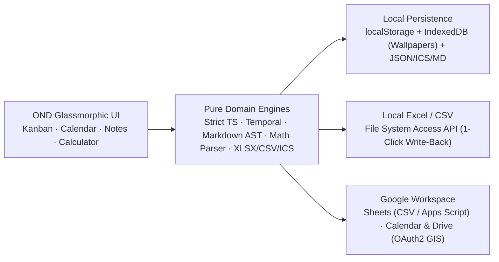

<div align="center">


# OND

**A local-first, glassmorphic desktop workspace with custom wallpapers — combining customizable Google Sheets & Excel Kanban, Temporal Calendar, Markdown Notes, and a Scientific & Profession-Formula Calculator.**

[](https://react.dev)
[](https://www.typescriptlang.org)
[](https://vite.dev)
[](https://github.com/KRSTIVN/ond/releases/latest)
[](#spreadsheet-sync)
[](LICENSE)

<br />


</div>

---

## Why I Built This

> **Built for my own daily workflow — open to anyone who wants it.**

This project was shaped around how I actually use **Notion** every day, minus the bloat and rigid layout ceilings. Spreadsheets (**Google Sheets** & **Excel**) are unbeatable for capturing and owning raw data — especially when your AI agent is automatically researching, enriching, and filling your sheets in the background — while a great Kanban board keeps you in full control of human interaction and high-touch decisions where it matters most.

Because I build my own tools, I didn't have to settle for off-the-shelf UI: **OND** pushes past standard board templates with full-bleed atmospheric wallpapers, real-time glassmorphism optics, zero-latency drag-and-drop, and direct spreadsheet write-back — all running locally with **zero backend, zero accounts, and zero lock-in**.

---

## Highlights

| Capability | What It Does |
| :--- | :--- |
| **Spatial Dashboard & 4 UI Themes** | Optional **Spatial Dashboard** command center (left Upcoming Schedule + Pinned Notes rail, Hero Spotlight with KPI pills & pipeline stage strip, and 4-card bottom bento row) plus 4 switchable UI skins in **Themes**: **Liquid Glass** (glossy obsidian capsules with chromatic cyan/violet caustic rims), **VisionOS Spatial** (floating rounded platinum glass window + detached left vertical dock + pure-white primary pills), **Aurora Prism** (warm amber/magenta & emerald/gold liquid glass), and **Obsidian Classic**. Configure your default **Startup View** (`Kanban Board` or `Spatial Dashboard`). |
| **Customizable Kanban & Templates** | Ships with the default **6-Stage Sales & Leads Pipeline** (`Leads` → `Contacted` → `In Process` → `Waiting Approval` → `Done` → `Lost`), plus 1-click templates (*Product Sprint*, *Content Studio*, *Personal Notion Flow*), full manual column editing (add, rename, recolor, reorder, delete), and **auto-column creation from uploaded spreadsheet `Status` values**. |
| **Temporal Calendar** | Full month grid (`Temporal` API + `Mon`/`Sun` week start), category-coded events (`Focus`, `Meeting`, `Personal`, `Deadline`), day agenda panel, `.ics` import/export (Apple Calendar, Google Calendar, Outlook), and live **Kanban Follow-up Dates** on the grid. |
| **Markdown Notes** | Live split / edit / preview Markdown workspace with safe AST rendering (zero `dangerouslySetInnerHTML`), clickable `- [ ]` checklists, formatting toolbar, pinning, `#tags`, search, and `.md` import/export. |
| **Calculator & Formula Box** | Standard & Scientific modes (`DEG`/`RAD`), safe recursive-descent math parser (zero `eval`), calculation history tape, cross-industry search, and **99 one-click Industry Formulas** across 13 disciplines — led by **25 Solar & Renewable Energy** formulas (*kW DC sizing, yield, NEC 690/705, battery storage, payback, LCOE*) plus *Electrical & HVAC*, *Finance*, *Real Estate*, *Architecture*, *Engineering*, *Manufacturing*, *Marketing*, *Healthcare*, *Data & Statistics*, *Software & Cloud*, *Agriculture*, and *Chemistry*. |
| **Wallpaper Studio** | Curated high-contrast wallpapers — including **3 Poison Dart Frog on pure black studio backdrops** (*Cobalt Azureus*, *Golden Banded*, *Strawberry*), scenic photography, obsidian dark glass, minimal gradients, custom `IndexedDB` uploads, image URLs, and live **Backdrop Dimming** + **Glass Blur** sliders. |
| **Local + Google Sign-In Sync** | Save Calendar & Notes locally (`.json` live file write-back, `.ics`, `.md`), sync Kanban with local `.xlsx`/`.csv` files or Google Sheets, OR sign in with your own **Google OAuth Client ID** to sync directly with **Google Calendar** and **Google Drive** (tokens stay in memory only). |
| **Cross-Platform Desktop App & Updater** | 1-click native-feel standalone window launchers for both **Windows** (`.lnk`) and **macOS** (`~/Applications/OND.app`), plus a built-in **1-click in-app GitHub updater**. |
| **100% Local & Private** | No telemetry, no cloud middleman, no personal data in the repo. `.gitignore` hard-blocks `*.csv`, `*.xlsx`, `*.xls`, and `local-data/`. |

---

## Architecture



---

## Quick Start

```bash
git clone https://github.com/KRSTIVN/ond.git
cd ond
npm install
npm run build
npm start
```

Open **`http://127.0.0.1:5173/`** and click **Sync & Backup** to connect your spreadsheet, Calendar, or Notes (or click **Try Sample** to preview with fictional demo cards).

## One-Click Desktop App (Windows & macOS)

### Direct Click-to-Install (Recommended — No Node.js or Terminal Required)
Download the latest native installer from **[GitHub Releases](https://github.com/KRSTIVN/ond/releases/latest)**:

- **Windows (`.exe`)**: Download `OND-Setup-<version>-x64.exe` (or `arm64`) and double-click — installs silently in one click, creates Desktop & Start Menu shortcuts, and updates automatically in-app.
- **macOS (`.dmg`)**: Download `OND-<version>-universal.dmg` (Apple Silicon + Intel), open it, and drag **OND** into **Applications**. *(First launch on unsigned builds: right-click `OND.app` → **Open**.)*

### Developer / Local Script Mode
```powershell
# Windows local shortcut
npm run install:win

# macOS local bundle
npm run install:mac

# Build native installers locally
npm run dist:win   # outputs release/OND-Setup-*.exe
npm run dist:mac   # outputs release/OND-*-universal.dmg
```

---

## Spreadsheet Sync

**OND** auto-maps flexible column headers from any Google Sheet or Excel workbook, preserves existing card stages across re-imports, and can automatically create custom Kanban columns from any `Status` values in your sheet:

| Spreadsheet Column | Recognized Header Aliases |
| :--- | :--- |
| **Card Title** *(required)* | `Business Name`, `Business`, `Company`, `Client`, `Title`, `Name` |
| **Stage** | `Status`, `Stage`, `Column`, `Phase` *(matches existing stages or auto-creates custom columns)* |
| **Category** | `Category`, `Industry`, `Niche`, `Service` |
| **Location** | `Address`, `Location`, `City` |
| **Contact** | `Phone Number` / `Phone`, `Email`, `Website URL` / `Website` |
| **Tag & Value** | `Lead Type` / `Type` / `Tag`, `Deal Value` / `Value` / `Budget`, `Follow-up Date` |
| **Notes** | `Notes`, `Note`, `Comments`, `Description` |

### Syncing Calendar & Notes with Google Sign-In
1. Click **Sync & Backup → Calendar & Notes (Local & Google)**.
2. Use **Local Backup** (`.json` / `.ics` / `.md`) for 100% offline backups, **or** paste your own Google Cloud Web OAuth Client ID (with `http://127.0.0.1:5173` in Authorized JavaScript origins) and click **Sign in with Google** to Pull/Push Google Calendar events and back up Notes + Calendar to Google Drive.

---

## Tech Stack & Credits

- **Frontend**: React 19, TypeScript (`strict: true`), Vite 6, Lucide Icons, native HTML `<dialog>` (`closedby="any"` + fallback), CSS `backdrop-filter` glassmorphism.
- **Workspace Engines**: `temporal-polyfill`, custom safe Markdown AST renderer, safe recursive-descent scientific & formula math parser, `read-excel-file` + `write-excel-file` (0 vulnerabilities), RFC-5545 `.ics` serializer/parser, on-demand Google Identity Services OAuth2.
- **Desktop Runtime**: Zero-dependency Node.js static server + localhost in-app updater (`server.mjs`), silent Windows WSH/PowerShell launcher, and native macOS `.app` bundle installer.
- **Poison Dart Frog Photography Credits** *(re-framed onto black studio backdrops)*: *Dendrobates tinctorius azureus* (CC BY 3.0), *Dendrobates leucomelas* (CC BY 3.0), and *Oophaga pumilio* (CC BY-SA 3.0) via Wikimedia Commons.

---

## License

[MIT](LICENSE) — fork it, customize the templates or wallpapers, and make it yours.
