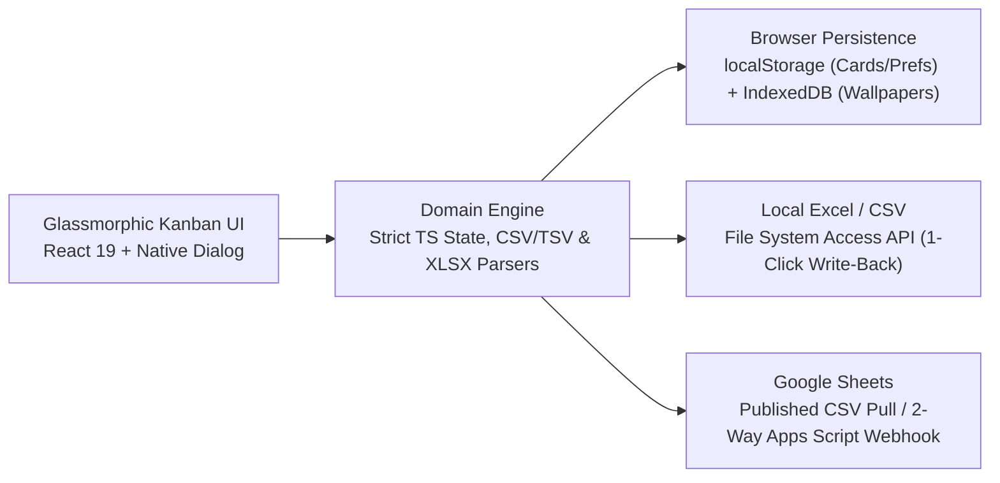

<div align="center">


# SheetKanban

**Turn any Google Sheet or Excel workbook into a glassmorphic, wallpaper-backed Kanban desktop app.**

[](https://react.dev)
[](https://www.typescriptlang.org)
[](https://vite.dev)
[](#spreadsheet-sync)
[](LICENSE)

<br />


</div>

---

## Why I Built This

> **Built for my own daily workflow — open to anyone who wants it.**

This project was shaped around how I actually use **Notion** every day, minus the bloat and rigid layout ceilings. Spreadsheets (**Google Sheets** & **Excel**) are unbeatable for capturing and owning raw data, while a great Kanban board is unbeatable for executing on it.

Because I build my own tools, I didn't have to settle for off-the-shelf UI: **SheetKanban** pushes past standard board templates with full-bleed atmospheric wallpapers, real-time glassmorphism optics, zero-latency drag-and-drop, and direct spreadsheet write-back — all running locally with **zero backend, zero accounts, and zero lock-in**.

---

## Highlights

| Capability | What It Does |
| :--- | :--- |
| **6-Stage Drag & Drop** | `Leads` → `Contacted` → `In Process` → `Waiting Approval` → `Done` → `Lost` with intra-column reordering, instant search, type/city filters, and live `$` pipeline rollups. |
| **Wallpaper Studio** | Curated 16:9 scenic & obsidian-glass backdrops, minimal gradients, **custom image upload** (stored in `IndexedDB` so high-res photos never hit `localStorage` limits), image URLs, plus live **Backdrop Dimming** and **Glass Blur** sliders. |
| **Interactive Excel (`.xlsx` / `.csv`)** | Connect a local `.xlsx` or `.csv` file via the File System Access API (Chrome/Edge) to edit cards visually and **save updates directly back to disk in 1 click**. Also supports standard `.xlsx`/`.csv` import/export and TSV (`A1`) copy-paste. |
| **Google Sheets Live Sync** | Pull from a Published-to-Web CSV link, paste cells directly, or drop in the built-in 20-line **Google Apps Script** bridge for 1-click **Pull & Push** with private Google Sheets. |
| **1-Click Desktop App Mode** | Ships with a silent Windows launcher + Desktop/Start Menu shortcut installer that starts the local server invisibly and opens a standalone frameless desktop window (`--app` mode) with a custom taskbar icon. |
| **100% Local & Private** | No telemetry, no cloud middleman, no personal data in the repo. `.gitignore` hard-blocks `*.csv`, `*.xlsx`, `*.xls`, and `local-data/`. |

---

## Architecture



---

## Quick Start

```bash
git clone https://github.com/KRSTIVN/sheet-kanban.git
cd sheet-kanban
npm install
npm run build
npm start
```

Open **`http://127.0.0.1:5173/`** and click **Sheets / Excel** to connect your spreadsheet (or click **Try Sample** to preview with fictional demo cards).

### Install as a 1-Click Windows Desktop App

After building (`npm run build`), run:

```powershell
powershell -ExecutionPolicy Bypass -File .\scripts\install-shortcut.ps1
```

This installs a **SheetKanban** icon on your **Desktop** and **Start Menu**:
- Double-click once → silently boots `server.mjs` (if not already running) with zero console flash → opens **SheetKanban** in a clean standalone desktop window.
- Right-click the shortcut → **Pin to taskbar** for single-click access.

---

## Spreadsheet Sync

**SheetKanban** auto-maps flexible column headers from any Google Sheet or Excel workbook and preserves your Kanban stages across re-imports:

| Spreadsheet Column | Recognized Header Aliases |
| :--- | :--- |
| **Card Title** *(required)* | `Business Name`, `Business`, `Company`, `Client`, `Title`, `Name` |
| **Stage** | `Status`, `Stage`, `Column`, `Phase` *(auto-maps to the 6 columns)* |
| **Category** | `Category`, `Industry`, `Niche`, `Service` |
| **Location** | `Address`, `Location`, `City` |
| **Contact** | `Phone Number` / `Phone`, `Email`, `Website URL` / `Website` |
| **Tag & Value** | `Lead Type` / `Type` / `Tag`, `Deal Value` / `Value` / `Budget`, `Follow-up Date` |
| **Notes** | `Notes`, `Note`, `Comments`, `Description` |

### Connecting a Private Google Sheet (2-Way Sync)
1. Click **Sheets / Excel** inside the app → expand **View Apps Script** → **Copy Code**.
2. In your Google Sheet, open **Extensions → Apps Script**, paste the snippet, and deploy as a **Web App** (*Execute as: Me*, *Who has access: Anyone*).
3. Paste the deployed `/exec` URL into **SheetKanban** for 1-click **Pull** and **Push**.

---

## Tech Stack

- **Frontend**: React 19, TypeScript (`strict: true`), Vite 6, Lucide Icons, native HTML `<dialog>` (`closedby="any"` + fallback), CSS `backdrop-filter` glassmorphism.
- **Excel Engine**: `read-excel-file` + `write-excel-file` (browser-native `.xlsx`, 0 vulnerabilities).
- **Desktop Runtime**: Zero-dependency Node.js static server (`server.mjs`) + silent WSH/PowerShell launcher (`scripts/`).

---

## License

[MIT](LICENSE) — fork it, customize the columns or wallpapers, and make it yours.
